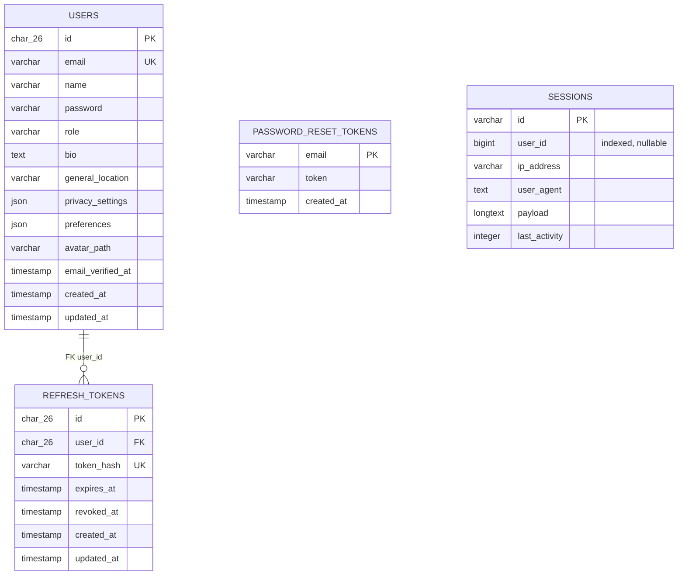

# Modelo relacional de Accounts

El servicio Accounts es dueño de la identidad, los perfiles y los refresh tokens. Su esquema es `catalogo_aves_accounts`.

## Relación física

| Origen | Destino | Cardinalidad | Integridad |
| --- | --- | --- | --- |
| `refresh_tokens.user_id` | `users.id` | Un usuario tiene cero o muchos refresh tokens | Foreign key con borrado en cascada. |

`refresh_tokens` guarda únicamente el hash del token. Al eliminar un usuario, MySQL elimina sus refresh tokens asociados.

## Referencias lógicas desde otros servicios

Accounts no tiene relaciones SQL con las bases de Catalog, Observation o Community. Sin embargo, al iniciar sesión firma un JWT cuyo sujeto es `users.id`. Los otros servicios usan ese identificador como un ULID opaco:

| Servicio consumidor | Campo que recibe el ID | Uso en código |
| --- | --- | --- |
| Observation | `sightings.user_id` | Filtrar la bitácora, autorizar edición y asignar propiedad al crear un avistamiento. |
| Community | `posts.author_id`, `comments.author_id`, `reactions.user_id`, `follows.*_id`, `reports.reporter_id`, `audit_records.actor_id`, `notifications.user_id` | Autoría, reacciones, seguimiento, moderación y destinatarios de alertas. |
| Catalog | Ningún ID de usuario persistido actualmente | Usa el JWT y sus roles para autorizar la edición editorial. |

Estas referencias no son claves foráneas: Catalog, Observation y Community validan la firma del JWT usando la clave pública de Accounts y no consultan su base de datos en cada petición.

## Tablas de soporte

- `password_reset_tokens`: almacena tokens para recuperación de contraseña, indexados por correo.
- `sessions`: tabla estándar de sesión Laravel; `user_id` tiene índice, no una foreign key explícita en la migración actual.
- `cache`, `cache_locks`, `jobs`, `job_batches` y `failed_jobs`: infraestructura de Laravel; no representan entidades del dominio.
