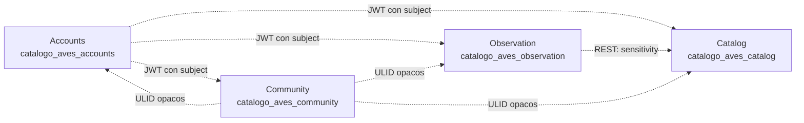
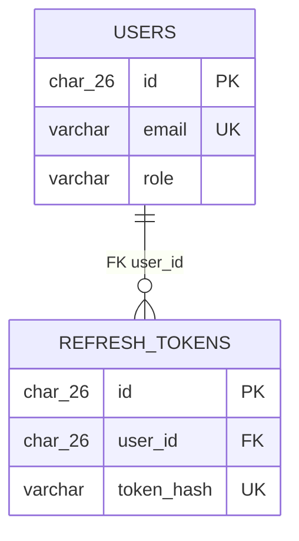
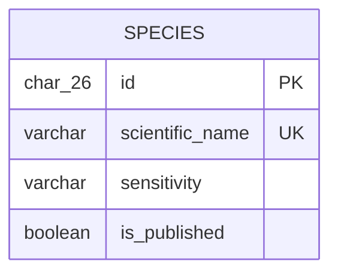
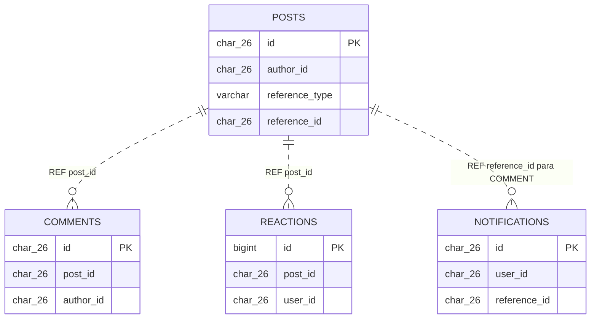

# DOCUMENTACIÓN TÉCNICA DE LAS BASES DE DATOS — ARQUITECTURA DE MICROSERVICIOS

# 1. Información general

## 1.1 Portada

| Metadato | Valor |
| --- | --- |
| Proyecto | Catálogo de Aves |
| Versión del documento | 1.0 |
| Fecha | 2026-11-05 |
| Estado | Línea base documental derivada del código fuente |
| Responsable técnico identificado | No determinado en las fuentes revisadas |
| Elaboración | Codex, a partir de las fuentes trazables del repositorio |
| Revisión de código analizada | `94c380f1cf20bae94cf5dc2320b3fcb831f382bb` |

## 1.2 Control de versiones

| Versión | Fecha | Cambio | Responsable |
| --- | --- | --- | --- |
| 1.0 | 2026-11-05 | Primera línea base técnica basada en migraciones, código, configuración y contratos del repositorio. | Codex |

---

## 1.3 Introducción, objetivo y alcance

Este documento registra la estructura de persistencia verificable de Catálogo de Aves. Su alcance son las cuatro bases de datos lógicas definidas en el proyecto, sus tablas creadas por migraciones de aplicación, columnas, claves, índices, restricciones y asociaciones observables en el código.

La descripción se organiza por responsabilidad, límites y relaciones, siguiendo principios de ISO/IEC/IEEE 42010; los diccionarios mantienen metadatos de nombre, tipo, nulabilidad y restricciones según el enfoque de ISO/IEC 11179; y la organización por componentes y diseño toma como referencia IEEE 1016. Estas referencias son metodológicas: no se declara certificación de conformidad con dichas normas.

No se realizó una consulta de solo lectura a una instancia MySQL en ejecución. Por ello, la fuente de autoridad de la estructura física es el conjunto de migraciones versionadas. El capítulo 10 identifica lo que no puede confirmarse sin inspección runtime.

## 1.4 Arquitectura de datos

| Microservicio | Base de datos | Motor confirmado | Responsabilidad confirmada |
| --- | --- | --- | --- |
| `accounts-service` | `catalogo_aves_accounts` | MySQL 8.4 en `compose.yaml` | Usuarios, perfiles, roles y refresh tokens. |
| `catalog-service` | `catalogo_aves_catalog` | MySQL 8.4 en `compose.yaml` | Especies y sensibilidad geográfica editorial. |
| `observation-service` | `catalogo_aves_observation` | MySQL 8.4 en `compose.yaml` | Avistamientos, proyecciones geográficas, lugares y rutas. |
| `community-service` | `catalogo_aves_community` | MySQL 8.4 en `compose.yaml` | Publicaciones, interacción, moderación y notificaciones. |

Cada servicio contiene su propio directorio `database/migrations`. Las decisiones arquitectónicas y las migraciones establecen que no debe haber foreign keys ni joins entre bases lógicas distintas. El único vínculo SQL físico entre entidades de negocio identificado en las fuentes es `refresh_tokens.user_id → users.id` dentro de Accounts.



## 1.5 Convenciones de documentación

| Convención | Significado |
| --- | --- |
| **[C] Confirmada** | Declarada directamente en migración, configuración, código o documentación fuente citada. |
| **[D] Derivada** | Conclusión determinista a partir de evidencia. Ejemplo: una FK no única desde `refresh_tokens` implica relación uno a muchos. |
| **[NV] No verificada** | No se determinó con la evidencia disponible; no se presenta como hecho. |
| `PK` | Clave primaria. |
| `FK` | Clave foránea física declarada por la migración. |
| `REF` | Referencia lógica usada por código o API; no es una FK. |
| `UK` | Restricción única. |
| `INDEX` | Índice no único declarado explícitamente. |
| `NULL` | La columna admite valor nulo. |
| `—` | No declarado en la fuente revisada. |

Los tipos se expresan como el tipo MySQL que genera el método de migración Laravel. Por ejemplo, `ulid()` se registra como `CHAR(26)` y `id()` como `BIGINT UNSIGNED AUTO_INCREMENT`.

## 1.6 Tablas de infraestructura Laravel compartidas

Las siguientes cinco tablas se crean con migraciones idénticas en los cuatro servicios. Cada aparición se lista en el inventario de su base; este apartado contiene el diccionario completo común. [C: S-A2, S-C1, S-O1, S-M1]

### 1.4.1 `cache`

| Campo | Tipo de dato | Nulo | PK | FK | Valor por defecto | Restricciones | Descripción verificable |
| --- | --- | :---: | :---: | :---: | --- | --- | --- |
| `key` | `VARCHAR(255)` | No | Sí | No | — | PK | Clave de la entrada de caché. |
| `value` | `MEDIUMTEXT` | No | No | No | — | — | Valor almacenado por la caché. |
| `expiration` | `INT` | No | No | No | — | — | Marca de expiración usada por la caché. |

### 1.4.2 `cache_locks`

| Campo | Tipo de dato | Nulo | PK | FK | Valor por defecto | Restricciones | Descripción verificable |
| --- | --- | :---: | :---: | :---: | --- | --- | --- |
| `key` | `VARCHAR(255)` | No | Sí | No | — | PK | Identificador del bloqueo de caché. |
| `owner` | `VARCHAR(255)` | No | No | No | — | — | Propietario del bloqueo. |
| `expiration` | `INT` | No | No | No | — | — | Marca de expiración del bloqueo. |

### 1.4.3 `jobs`

| Campo | Tipo de dato | Nulo | PK | FK | Valor por defecto | Restricciones | Descripción verificable |
| --- | --- | :---: | :---: | :---: | --- | --- | --- |
| `id` | `BIGINT UNSIGNED` | No | Sí | No | Auto incremento | PK | Identificador del trabajo en cola. |
| `queue` | `VARCHAR(255)` | No | No | No | — | INDEX | Nombre de la cola. |
| `payload` | `LONGTEXT` | No | No | No | — | — | Carga útil serializada del trabajo. |
| `attempts` | `TINYINT UNSIGNED` | No | No | No | — | — | Número de intentos. |
| `reserved_at` | `INT UNSIGNED` | Sí | No | No | `NULL` | — | Marca de reserva. |
| `available_at` | `INT UNSIGNED` | No | No | No | — | — | Momento de disponibilidad. |
| `created_at` | `INT UNSIGNED` | No | No | No | — | — | Momento de creación del trabajo. |

### 1.4.4 `job_batches`

| Campo | Tipo de dato | Nulo | PK | FK | Valor por defecto | Restricciones | Descripción verificable |
| --- | --- | :---: | :---: | :---: | --- | --- | --- |
| `id` | `VARCHAR(255)` | No | Sí | No | — | PK | Identificador del lote. |
| `name` | `VARCHAR(255)` | No | No | No | — | — | Nombre del lote. |
| `total_jobs` | `INT` | No | No | No | — | — | Total de trabajos del lote. |
| `pending_jobs` | `INT` | No | No | No | — | — | Trabajos pendientes. |
| `failed_jobs` | `INT` | No | No | No | — | — | Trabajos fallidos. |
| `failed_job_ids` | `LONGTEXT` | No | No | No | — | — | Identificadores de trabajos fallidos. |
| `options` | `MEDIUMTEXT` | Sí | No | No | `NULL` | — | Opciones serializadas del lote. |
| `cancelled_at` | `INT` | Sí | No | No | `NULL` | — | Marca de cancelación. |
| `created_at` | `INT` | No | No | No | — | — | Momento de creación. |
| `finished_at` | `INT` | Sí | No | No | `NULL` | — | Momento de finalización. |

### 1.4.5 `failed_jobs`

| Campo | Tipo de dato | Nulo | PK | FK | Valor por defecto | Restricciones | Descripción verificable |
| --- | --- | :---: | :---: | :---: | --- | --- | --- |
| `id` | `BIGINT UNSIGNED` | No | Sí | No | Auto incremento | PK | Identificador interno. |
| `uuid` | `VARCHAR(255)` | No | No | No | — | UK | UUID del trabajo fallido. |
| `connection` | `TEXT` | No | No | No | — | — | Conexión de cola registrada. |
| `queue` | `TEXT` | No | No | No | — | — | Cola registrada. |
| `payload` | `LONGTEXT` | No | No | No | — | — | Carga útil del trabajo. |
| `exception` | `LONGTEXT` | No | No | No | — | — | Excepción registrada. |
| `failed_at` | `TIMESTAMP` | No | No | No | `CURRENT_TIMESTAMP` | — | Momento del fallo. |

---

# 2. Base de datos Accounts

## 2.1 Identificación

| Atributo | Valor |
| --- | --- |
| Microservicio responsable | `accounts-service` |
| Base de datos | `catalogo_aves_accounts` |
| Motor configurado | MySQL 8.4 en Docker [C: S-G1] |
| Framework y versión bloqueada | Laravel `v12.69.2` [C: S-G2] |
| Migraciones de dominio | `0001_01_01_000000_create_users_table.php`, `2026_09_17_000100_add_cenit_profile_to_users.php`, `2026_09_17_000200_create_refresh_tokens_table.php` [C: S-A1] |

## 2.2 Descripción funcional

Accounts es propietario de usuarios, perfiles, roles y refresh tokens. `JwtService` firma access tokens RSA con el identificador de usuario como `sub`, un arreglo de roles y permisos derivados del rol. Los demás servicios verifican dichos tokens con clave pública local. [C: S-A3, S-G3]

## 2.3 Inventario de tablas

| N.º | Tabla | Descripción verificable | Origen |
| :---: | --- | --- | --- |
| 1 | `users` | Cuentas, datos de perfil y rol. | S-A1 |
| 2 | `refresh_tokens` | Tokens de renovación con hash, expiración y revocación. | S-A1 |
| 3 | `password_reset_tokens` | Tokens de restablecimiento asociados por correo. | S-A1 |
| 4 | `sessions` | Sesiones estándar Laravel. | S-A1 |
| 5 | `cache` | Infraestructura de caché. | S-A2 |
| 6 | `cache_locks` | Bloqueos de caché. | S-A2 |
| 7 | `jobs` | Trabajos en cola. | S-A2 |
| 8 | `job_batches` | Lotes de trabajos. | S-A2 |
| 9 | `failed_jobs` | Registro de trabajos fallidos. | S-A2 |

## 2.4 Diccionario de datos

### 2.4.1 `users`

| Campo | Tipo de dato | Nulo | PK | FK | Valor por defecto | Restricciones | Descripción verificable |
| --- | --- | :---: | :---: | :---: | --- | --- | --- |
| `id` | `CHAR(26)` | No | Sí | No | — | PK | ULID de usuario. |
| `name` | `VARCHAR(255)` | No | No | No | — | — | Nombre de usuario. |
| `email` | `VARCHAR(255)` | No | No | No | — | UK | Correo de usuario. |
| `email_verified_at` | `TIMESTAMP` | Sí | No | No | `NULL` | — | Marca de validación de correo. |
| `password` | `VARCHAR(255)` | No | No | No | — | — | Contraseña almacenada; el modelo aplica cast `hashed`. |
| `remember_token` | `VARCHAR(100)` | Sí | No | No | `NULL` | — | Token de recuerdo estándar Laravel. |
| `role` | `VARCHAR(255)` | No | No | No | `user` | — | Rol de usuario. |
| `bio` | `TEXT` | Sí | No | No | `NULL` | — | Biografía del perfil. |
| `general_location` | `VARCHAR(255)` | Sí | No | No | `NULL` | — | Ubicación general declarada. |
| `privacy_settings` | `JSON` | Sí | No | No | `NULL` | — | Ajustes de privacidad; cast a arreglo en modelo. |
| `preferences` | `JSON` | Sí | No | No | `NULL` | — | Preferencias; cast a arreglo en modelo. |
| `avatar_path` | `VARCHAR(255)` | Sí | No | No | `NULL` | — | Ruta de avatar. |
| `created_at` | `TIMESTAMP` | Sí | No | No | `NULL` | — | Marca temporal Laravel. |
| `updated_at` | `TIMESTAMP` | Sí | No | No | `NULL` | — | Marca temporal Laravel. |

Fuente: S-A1; casts y roles: S-A3.

### 2.4.2 `refresh_tokens`

| Campo | Tipo de dato | Nulo | PK | FK | Valor por defecto | Restricciones | Descripción verificable |
| --- | --- | :---: | :---: | :---: | --- | --- | --- |
| `id` | `CHAR(26)` | No | Sí | No | — | PK | ULID del refresh token. |
| `user_id` | `CHAR(26)` | No | No | Sí → `users.id` | — | FK, `ON DELETE CASCADE` | Usuario dueño del token. |
| `token_hash` | `VARCHAR(64)` | No | No | No | — | UK | Hash SHA-256 del token según la migración. |
| `expires_at` | `TIMESTAMP` | No | No | No | — | — | Expiración. |
| `revoked_at` | `TIMESTAMP` | Sí | No | No | `NULL` | — | Momento de revocación. |
| `created_at` | `TIMESTAMP` | Sí | No | No | `NULL` | — | Marca temporal Laravel. |
| `updated_at` | `TIMESTAMP` | Sí | No | No | `NULL` | — | Marca temporal Laravel. |

Fuente: S-A1. La migración no declara acción `ON UPDATE`; el comportamiento efectivo debe verificarse en el DDL runtime. [NV]

### 2.4.3 `password_reset_tokens`

| Campo | Tipo de dato | Nulo | PK | FK | Valor por defecto | Restricciones | Descripción verificable |
| --- | --- | :---: | :---: | :---: | --- | --- | --- |
| `email` | `VARCHAR(255)` | No | Sí | No | — | PK | Correo asociado al token. |
| `token` | `VARCHAR(255)` | No | No | No | — | — | Token de restablecimiento. |
| `created_at` | `TIMESTAMP` | Sí | No | No | `NULL` | — | Momento de creación. |

Fuente: S-A1.

### 2.4.4 `sessions`

| Campo | Tipo de dato | Nulo | PK | FK | Valor por defecto | Restricciones | Descripción verificable |
| --- | --- | :---: | :---: | :---: | --- | --- | --- |
| `id` | `VARCHAR(255)` | No | Sí | No | — | PK | Identificador de sesión. |
| `user_id` | `BIGINT UNSIGNED` | Sí | No | No | `NULL` | INDEX | Identificador de usuario definido por migración estándar; no hay FK. |
| `ip_address` | `VARCHAR(45)` | Sí | No | No | `NULL` | — | Dirección IP de sesión. |
| `user_agent` | `TEXT` | Sí | No | No | `NULL` | — | Agente de usuario. |
| `payload` | `LONGTEXT` | No | No | No | — | — | Carga de sesión. |
| `last_activity` | `INT` | No | No | No | — | INDEX | Marca de última actividad. |

Fuente: S-A1. Observación: `sessions.user_id` es `BIGINT UNSIGNED`, mientras que `users.id` es `CHAR(26)`; no existe FK y la migración no establece una asociación física. [C]

Las tablas `cache`, `cache_locks`, `jobs`, `job_batches` y `failed_jobs` usan el diccionario completo de 1.4. Fuente: S-A2.

## 2.5 Relaciones y diagrama

| Origen | Columna | Destino | Cardinalidad | Tipo | Integridad / evidencia |
| --- | --- | --- | --- | --- | --- |
| `refresh_tokens` | `user_id` | `users.id` | Un usuario a cero o muchos tokens [D] | FK física | FK y `cascadeOnDelete()` en S-A1. |



## 2.6 Índices y restricciones

- `users`: PK `id`; UK `email`. [C: S-A1]
- `refresh_tokens`: PK `id`; UK `token_hash`; FK `user_id`; índice generado por la FK. [C: S-A1]
- `sessions`: PK `id`; índices no únicos en `user_id` y `last_activity`. [C: S-A1]
- Infraestructura: consulte 1.4. [C: S-A2]
- No hay restricciones `CHECK` declaradas en las migraciones de Accounts. [C: S-A1, S-A2]

## 2.7 Reglas de negocio, seguridad y operación

- `User::permissions()` deriva permisos desde `role` al emitir el JWT. [C: S-A3]
- `JwtService` emite tokens firmados RSA con emisor, sujeto, roles, permisos y expiración. [C: S-A3]
- `AuthController` mantiene el ciclo de vida de refresh tokens y se documenta que persiste hashes, no valores brutos. [C: S-G3]
- `CorrelationId` y `AuthenticateJwt` son middleware común de trazabilidad y validación de JWT. [C: S-G3]
- Las migraciones se aplican mediante `prepare`; el comando `fresh` es destructivo. [C: S-G4]

## 2.8 Observaciones técnicas

- La discrepancia de tipo entre `users.id` y `sessions.user_id` está confirmada en la migración; no se debe interpretar como relación física. [C]
- Backups, retención, recuperación, cifrado en reposo y políticas de borrado de usuarios: no determinados con la evidencia disponible. [NV]

---

# 3. Base de datos Catalog

## 3.1 Identificación y descripción funcional

| Atributo | Valor |
| --- | --- |
| Microservicio responsable | `catalog-service` |
| Base de datos | `catalogo_aves_catalog` |
| Motor configurado | MySQL 8.4 en Docker [C: S-G1] |
| Tabla de dominio | `species` [C: S-C1] |

Catalog es la fuente de verdad editorial de especies y su sensibilidad geográfica. `SpeciesController` expone lectura pública y limita las mutaciones administrativas mediante JWT; el valor de `sensitivity` es consumido por Observation durante la publicación. [C: S-G3]

## 3.2 Inventario de tablas

| N.º | Tabla | Descripción verificable | Origen |
| :---: | --- | --- | --- |
| 1 | `species` | Datos editoriales y sensibilidad de especie. | S-C1 |
| 2 | `cache` | Infraestructura de caché. | S-C2 |
| 3 | `cache_locks` | Bloqueos de caché. | S-C2 |
| 4 | `jobs` | Trabajos en cola. | S-C2 |
| 5 | `job_batches` | Lotes de trabajos. | S-C2 |
| 6 | `failed_jobs` | Trabajos fallidos. | S-C2 |

## 3.3 Diccionario de datos

### 3.3.1 `species`

| Campo | Tipo de dato | Nulo | PK | FK | Valor por defecto | Restricciones | Descripción verificable |
| --- | --- | :---: | :---: | :---: | --- | --- | --- |
| `id` | `CHAR(26)` | No | Sí | No | — | PK | ULID de especie. |
| `common_name` | `VARCHAR(255)` | No | No | No | — | — | Nombre común. |
| `scientific_name` | `VARCHAR(255)` | No | No | No | — | UK | Nombre científico. |
| `taxonomy` | `JSON` | Sí | No | No | `NULL` | — | Taxonomía; cast a arreglo en modelo. |
| `description` | `TEXT` | Sí | No | No | `NULL` | — | Descripción. |
| `size` | `VARCHAR(255)` | Sí | No | No | `NULL` | — | Tamaño. |
| `habitat` | `TEXT` | Sí | No | No | `NULL` | — | Hábitat. |
| `feeding` | `TEXT` | Sí | No | No | `NULL` | — | Alimentación. |
| `distribution` | `TEXT` | Sí | No | No | `NULL` | — | Distribución. |
| `typical_hours` | `JSON` | Sí | No | No | `NULL` | — | Horarios típicos; cast a arreglo. |
| `seasons` | `JSON` | Sí | No | No | `NULL` | — | Estaciones; cast a arreglo. |
| `similar_species` | `JSON` | Sí | No | No | `NULL` | — | Especies similares; cast a arreglo. |
| `distinguishing_features` | `TEXT` | Sí | No | No | `NULL` | — | Rasgos distintivos. |
| `conservation_status` | `VARCHAR(255)` | Sí | No | No | `NULL` | — | Estado de conservación. |
| `sensitivity` | `VARCHAR(255)` | No | No | No | `EXACT` | — | Sensibilidad geográfica editorial. |
| `is_published` | `TINYINT(1)` | No | No | No | `1` | — | Indicador de publicación. |
| `created_at` | `TIMESTAMP` | Sí | No | No | `NULL` | — | Marca temporal Laravel. |
| `updated_at` | `TIMESTAMP` | Sí | No | No | `NULL` | — | Marca temporal Laravel. |

Fuente: S-C1; casts: `apps/services/catalog-service/app/Models/Species.php` [S-C3]. Las tablas de infraestructura usan 1.4; fuente S-C2.

## 3.4 Relaciones, índices y restricciones

No se declara una FK en Catalog. `scientific_name` es UNIQUE; `id` es PK. No hay `CHECK` en sus migraciones. [C: S-C1]

`Observation.sightings.species_id` es una REF externa a `species.id`, no una FK. La asociación se realiza mediante el cliente HTTP `CatalogSensitivityClient` y sólo cuando se publica una observación con especie. [C: S-O3, S-G3]



## 3.5 Reglas de negocio, seguridad y operación

- `SpeciesController::index` filtra por `is_published = true`. [C: S-C4]
- Las rutas `POST` y `PUT` de especies están bajo middleware JWT con prefijo `admin`; la autorización detallada está en el controlador y roles del token. [C: S-C5, S-G3]
- Los valores `EXACT`, `APPROXIMATE` y `HIDDEN` aparecen como política usada por `LocationPrivacy`; la migración no declara un `ENUM` ni `CHECK` para limitar físicamente `sensitivity`. [C: S-C1, S-O4]

## 3.6 Observaciones técnicas

- No se evidencia una FK desde `sightings.species_id`; la ausencia es intencional según los límites de servicio. [C: S-G3]
- Vistas, triggers, procedimientos, charset/collation, engine real y backups no se determinaron sin inspección runtime. [NV]

---

# 4. Base de datos Observation

## 4.1 Identificación y descripción funcional

| Atributo | Valor |
| --- | --- |
| Microservicio responsable | `observation-service` |
| Base de datos | `catalogo_aves_observation` |
| Motor configurado | MySQL 8.4 en Docker [C: S-G1] |
| Tablas de dominio | `sightings`, `places`, `birding_routes` [C: S-O1] |

Observation es propietario de los avistamientos y de dos proyecciones geográficas: privada y pública. También expone lugares y rutas de avistamiento. [C: S-G3]

## 4.2 Inventario de tablas

| N.º | Tabla | Descripción verificable | Origen |
| :---: | --- | --- | --- |
| 1 | `sightings` | Avistamientos con ubicación privada y proyección pública. | S-O1, S-O2 |
| 2 | `places` | Lugares públicos de observación. | S-O1 |
| 3 | `birding_routes` | Rutas asociadas lógicamente a lugares. | S-O1 |
| 4 | `cache` | Infraestructura de caché. | S-O5 |
| 5 | `cache_locks` | Bloqueos de caché. | S-O5 |
| 6 | `jobs` | Trabajos en cola. | S-O5 |
| 7 | `job_batches` | Lotes de trabajos. | S-O5 |
| 8 | `failed_jobs` | Trabajos fallidos. | S-O5 |

## 4.3 Diccionario de datos

### 4.3.1 `sightings`

| Campo | Tipo de dato | Nulo | PK | FK | Valor por defecto | Restricciones | Descripción verificable |
| --- | --- | :---: | :---: | :---: | --- | --- | --- |
| `id` | `CHAR(26)` | No | Sí | No | — | PK | ULID de avistamiento. |
| `user_id` | `CHAR(26)` | No | No | No | — | INDEX; REF Accounts | Dueño lógico del avistamiento. |
| `species_id` | `CHAR(26)` | Sí | No | No | `NULL` | INDEX; REF Catalog | Especie lógica, opcional. |
| `observed_at` | `TIMESTAMP` | No | No | No | — | INDEX | Momento de observación. |
| `individuals` | `INT UNSIGNED` | No | No | No | `1` | — | Número de individuos. |
| `behavior` | `VARCHAR(255)` | Sí | No | No | `NULL` | — | Comportamiento registrado. |
| `notes` | `TEXT` | Sí | No | No | `NULL` | — | Notas del avistamiento. |
| `status` | `VARCHAR(255)` | No | No | No | — | INDEX | Estado de publicación. |
| `sensitivity` | `VARCHAR(255)` | No | No | No | `HIDDEN` | — | Sensibilidad aplicada. |
| `private_lat` | `DECIMAL(10,7)` | No | No | No | — | — | Latitud privada. |
| `private_lng` | `DECIMAL(10,7)` | No | No | No | — | — | Longitud privada. |
| `private_region` | `VARCHAR(255)` | Sí | No | No | `NULL` | — | Región privada. |
| `public_lat` | `DECIMAL(10,7)` | Sí | No | No | `NULL` | INDEX | Latitud apta para representación pública. |
| `public_lng` | `DECIMAL(10,7)` | Sí | No | No | `NULL` | INDEX | Longitud apta para representación pública. |
| `public_region` | `VARCHAR(255)` | Sí | No | No | `NULL` | — | Región apta para publicación. |
| `created_at` | `TIMESTAMP` | Sí | No | No | `NULL` | — | Marca temporal Laravel. |
| `updated_at` | `TIMESTAMP` | Sí | No | No | `NULL` | — | Marca temporal Laravel. |

Fuentes: S-O1, S-O2. `observed_at` tiene cast `datetime` en el modelo. [C: S-O6]

### 4.3.2 `places`

| Campo | Tipo de dato | Nulo | PK | FK | Valor por defecto | Restricciones | Descripción verificable |
| --- | --- | :---: | :---: | :---: | --- | --- | --- |
| `id` | `CHAR(26)` | No | Sí | No | — | PK | ULID del lugar. |
| `name` | `VARCHAR(255)` | No | No | No | — | — | Nombre. |
| `municipality` | `VARCHAR(255)` | No | No | No | — | — | Municipio. |
| `department` | `VARCHAR(255)` | No | No | No | — | — | Departamento. |
| `habitat` | `VARCHAR(255)` | No | No | No | — | — | Hábitat. |
| `description` | `TEXT` | No | No | No | — | — | Descripción. |
| `latitude` | `DECIMAL(10,7)` | No | No | No | — | — | Latitud pública. |
| `longitude` | `DECIMAL(10,7)` | No | No | No | — | — | Longitud pública. |
| `is_public` | `TINYINT(1)` | No | No | No | `1` | INDEX | Indicador de visibilidad. |
| `created_at` | `TIMESTAMP` | Sí | No | No | `NULL` | — | Marca temporal Laravel. |
| `updated_at` | `TIMESTAMP` | Sí | No | No | `NULL` | — | Marca temporal Laravel. |

Fuente: S-O1.

### 4.3.3 `birding_routes`

| Campo | Tipo de dato | Nulo | PK | FK | Valor por defecto | Restricciones | Descripción verificable |
| --- | --- | :---: | :---: | :---: | --- | --- | --- |
| `id` | `CHAR(26)` | No | Sí | No | — | PK | ULID de ruta. |
| `place_id` | `CHAR(26)` | No | No | No | — | INDEX; REF local | Identificador de lugar usado por consultas de rutas. |
| `name` | `VARCHAR(255)` | No | No | No | — | — | Nombre. |
| `difficulty` | `VARCHAR(255)` | No | No | No | — | — | Dificultad. |
| `duration_minutes` | `SMALLINT UNSIGNED` | No | No | No | — | — | Duración. |
| `distance_km` | `DECIMAL(5,2)` | No | No | No | — | — | Distancia. |
| `description` | `TEXT` | No | No | No | — | — | Descripción. |
| `start_latitude` | `DECIMAL(10,7)` | No | No | No | — | — | Latitud de inicio. |
| `start_longitude` | `DECIMAL(10,7)` | No | No | No | — | — | Longitud de inicio. |
| `is_public` | `TINYINT(1)` | No | No | No | `1` | INDEX | Indicador de visibilidad. |
| `created_at` | `TIMESTAMP` | Sí | No | No | `NULL` | — | Marca temporal Laravel. |
| `updated_at` | `TIMESTAMP` | Sí | No | No | `NULL` | — | Marca temporal Laravel. |

Fuente: S-O1. Las tablas de infraestructura usan 1.4; fuente S-O5.

## 4.4 Relaciones y diagrama

| Origen | Columna | Destino | Cardinalidad | Tipo | Integridad / evidencia |
| --- | --- | --- | --- | --- | --- |
| `sightings` | `user_id` | Accounts `users.id` | Un usuario puede poseer cero o muchos avistamientos [D] | REF externa | Filtro y asignación desde identidad JWT en `SightingController`. [C: S-O7] |
| `sightings` | `species_id` | Catalog `species.id` | Una especie puede ser referida por cero o muchos avistamientos [D] | REF externa | Consulta HTTP de sensibilidad en `CreateSighting`. [C: S-O3] |
| `birding_routes` | `place_id` | `places.id` | Un lugar puede tener cero o muchas rutas [D] | REF local | `PlanningController` filtra rutas por `place_id`; no existe FK. [C: S-O8] |

```mermaid
erDiagram
  USERS ..o{ SIGHTINGS : "REF user_id"
  SPECIES ..o{ SIGHTINGS : "REF species_id"
  PLACES ..o{ BIRDING_ROUTES : "REF place_id"
  SIGHTINGS {
    char_26 id PK
    char_26 user_id
    char_26 species_id
    decimal private_lat
    decimal private_lng
    decimal public_lat
    decimal public_lng
  }
```

## 4.5 Índices, restricciones y reglas de negocio

- `sightings`: PK `id`; índices en `user_id`, `species_id`, `observed_at`, `status`, `public_lat`, `public_lng`. [C: S-O1]
- `places`: PK `id`; índice en `is_public`. [C: S-O1]
- `birding_routes`: PK `id`; índices en `place_id` e `is_public`. [C: S-O1]
- No existen FK ni `CHECK` declarados en las migraciones de Observation. [C: S-O1, S-O2]
- Al crear o actualizar: si `publish` es falso, se usa estado `DRAFT` y coordenadas públicas nulas. [C: S-O3]
- Si se publica una especie identificada y Catalog no responde, la operación de publicación termina con `CATALOG_UNAVAILABLE`; no se persiste como publicación. [C: S-O3, S-O7]
- `LocationPrivacy` conserva coordenadas exactas para `EXACT`, aproxima a una celda de 0,05° para `APPROXIMATE` y oculta coordenadas para otros valores, incluyendo `HIDDEN`. [C: S-O4]
- El mapa selecciona `PUBLISHED`, `VERIFIED` y `NEEDS_IDENTIFICATION` con `public_lat` no nulo y el recurso no serializa coordenadas privadas. [C: S-O7, S-O9]

## 4.6 Seguridad, mantenimiento y observaciones

- La ubicación exacta se persiste separada de la proyección pública. `SightingResource` incluye `private_location` sólo cuando se solicita explícitamente una vista privada. [C: S-O9]
- `show`, `update` y `destroy` verifican propiedad mediante `user_id` e identidad JWT; `show` admite roles de revisión definidos en código. [C: S-O7]
- La información sobre respaldos, retención, cifrado de coordenadas en reposo, triggers y el esquema efectivo runtime no está disponible. [NV]

---

# 5. Base de datos Community

## 5.1 Identificación y descripción funcional

| Atributo | Valor |
| --- | --- |
| Microservicio responsable | `community-service` |
| Base de datos | `catalogo_aves_community` |
| Motor configurado | MySQL 8.4 en Docker [C: S-G1] |
| Tablas de dominio | `posts`, `comments`, `reactions`, `follows`, `reports`, `audit_records`, `notifications` [C: S-M1] |

Community administra publicaciones y la interacción asociada. El controlador usa `DB::table(...)`; no hay modelos Eloquent de dominio ni FK declaradas para estas tablas en la evidencia revisada. [C: S-M3]

## 5.2 Inventario de tablas

| N.º | Tabla | Descripción verificable | Origen |
| :---: | --- | --- | --- |
| 1 | `posts` | Publicaciones con referencia opcional por tipo e identificador. | S-M1 |
| 2 | `comments` | Comentarios de publicaciones. | S-M1 |
| 3 | `reactions` | Reacciones únicas por publicación y usuario. | S-M1 |
| 4 | `follows` | Relaciones de seguimiento entre IDs de usuario. | S-M1 |
| 5 | `reports` | Reportes de objetivos identificados por tipo e ID. | S-M1 |
| 6 | `audit_records` | Acciones de moderación registradas. | S-M1 |
| 7 | `notifications` | Notificaciones por destinatario. | S-M1 |
| 8 | `cache` | Infraestructura de caché. | S-M2 |
| 9 | `cache_locks` | Bloqueos de caché. | S-M2 |
| 10 | `jobs` | Trabajos en cola. | S-M2 |
| 11 | `job_batches` | Lotes de trabajos. | S-M2 |
| 12 | `failed_jobs` | Trabajos fallidos. | S-M2 |

## 5.3 Diccionario de datos

### 5.3.1 `posts`

| Campo | Tipo de dato | Nulo | PK | FK | Valor por defecto | Restricciones | Descripción verificable |
| --- | --- | :---: | :---: | :---: | --- | --- | --- |
| `id` | `CHAR(26)` | No | Sí | No | — | PK | ULID de publicación. |
| `author_id` | `CHAR(26)` | No | No | No | — | INDEX; REF Accounts | Autor lógico. |
| `body` | `TEXT` | Sí | No | No | `NULL` | — | Cuerpo de publicación. |
| `reference_type` | `VARCHAR(255)` | No | No | No | — | — | Tipo de referencia. |
| `reference_id` | `CHAR(26)` | No | No | No | — | — | ID de referencia. |
| `visibility` | `VARCHAR(255)` | No | No | No | `PUBLIC` | — | Visibilidad. |
| `created_at` | `TIMESTAMP` | Sí | No | No | `NULL` | — | Marca temporal Laravel. |
| `updated_at` | `TIMESTAMP` | Sí | No | No | `NULL` | — | Marca temporal Laravel. |

### 5.3.2 `comments`

| Campo | Tipo de dato | Nulo | PK | FK | Valor por defecto | Restricciones | Descripción verificable |
| --- | --- | :---: | :---: | :---: | --- | --- | --- |
| `id` | `CHAR(26)` | No | Sí | No | — | PK | ULID de comentario. |
| `post_id` | `CHAR(26)` | No | No | No | — | INDEX; REF local | Publicación lógica. |
| `author_id` | `CHAR(26)` | No | No | No | — | INDEX; REF Accounts | Autor lógico. |
| `body` | `TEXT` | No | No | No | — | — | Cuerpo del comentario. |
| `created_at` | `TIMESTAMP` | Sí | No | No | `NULL` | — | Marca temporal Laravel. |
| `updated_at` | `TIMESTAMP` | Sí | No | No | `NULL` | — | Marca temporal Laravel. |

### 5.3.3 `reactions`

| Campo | Tipo de dato | Nulo | PK | FK | Valor por defecto | Restricciones | Descripción verificable |
| --- | --- | :---: | :---: | :---: | --- | --- | --- |
| `id` | `BIGINT UNSIGNED` | No | Sí | No | Auto incremento | PK | Identificador interno. |
| `post_id` | `CHAR(26)` | No | No | No | — | UK compuesta; REF local | Publicación lógica. |
| `user_id` | `CHAR(26)` | No | No | No | — | UK compuesta; REF Accounts | Persona que reacciona. |
| `reaction` | `VARCHAR(255)` | No | No | No | — | — | Valor de reacción. |
| `created_at` | `TIMESTAMP` | Sí | No | No | `NULL` | — | Marca temporal Laravel. |
| `updated_at` | `TIMESTAMP` | Sí | No | No | `NULL` | — | Marca temporal Laravel. |

Restricción: UNIQUE (`post_id`, `user_id`). [C: S-M1]

### 5.3.4 `follows`

| Campo | Tipo de dato | Nulo | PK | FK | Valor por defecto | Restricciones | Descripción verificable |
| --- | --- | :---: | :---: | :---: | --- | --- | --- |
| `id` | `BIGINT UNSIGNED` | No | Sí | No | Auto incremento | PK | Identificador interno. |
| `follower_id` | `CHAR(26)` | No | No | No | — | UK compuesta; REF Accounts | Seguidor lógico. |
| `followed_id` | `CHAR(26)` | No | No | No | — | UK compuesta; REF Accounts | Usuario seguido lógico. |
| `created_at` | `TIMESTAMP` | Sí | No | No | `NULL` | — | Marca temporal Laravel. |
| `updated_at` | `TIMESTAMP` | Sí | No | No | `NULL` | — | Marca temporal Laravel. |

Restricción: UNIQUE (`follower_id`, `followed_id`). [C: S-M1]

### 5.3.5 `reports`

| Campo | Tipo de dato | Nulo | PK | FK | Valor por defecto | Restricciones | Descripción verificable |
| --- | --- | :---: | :---: | :---: | --- | --- | --- |
| `id` | `CHAR(26)` | No | Sí | No | — | PK | ULID de reporte. |
| `reporter_id` | `CHAR(26)` | No | No | No | — | — | Reportante lógico. |
| `target_type` | `VARCHAR(255)` | No | No | No | — | — | Tipo de objetivo. |
| `target_id` | `CHAR(26)` | No | No | No | — | — | ID de objetivo. |
| `reason` | `VARCHAR(255)` | No | No | No | — | — | Motivo. |
| `detail` | `TEXT` | Sí | No | No | `NULL` | — | Detalle opcional. |
| `status` | `VARCHAR(255)` | No | No | No | — | — | Estado de reporte. |
| `created_at` | `TIMESTAMP` | Sí | No | No | `NULL` | — | Marca temporal Laravel. |
| `updated_at` | `TIMESTAMP` | Sí | No | No | `NULL` | — | Marca temporal Laravel. |

### 5.3.6 `audit_records`

| Campo | Tipo de dato | Nulo | PK | FK | Valor por defecto | Restricciones | Descripción verificable |
| --- | --- | :---: | :---: | :---: | --- | --- | --- |
| `id` | `CHAR(26)` | No | Sí | No | — | PK | ULID de auditoría. |
| `actor_id` | `CHAR(26)` | No | No | No | — | — | Actor lógico. |
| `target_type` | `VARCHAR(255)` | No | No | No | — | — | Tipo de objetivo. |
| `target_id` | `CHAR(26)` | No | No | No | — | — | ID de objetivo. |
| `action` | `VARCHAR(255)` | No | No | No | — | — | Acción de moderación. |
| `reason` | `TEXT` | No | No | No | — | — | Motivo de la acción. |
| `created_at` | `TIMESTAMP` | Sí | No | No | `NULL` | — | Marca temporal Laravel. |
| `updated_at` | `TIMESTAMP` | Sí | No | No | `NULL` | — | Marca temporal Laravel. |

### 5.3.7 `notifications`

| Campo | Tipo de dato | Nulo | PK | FK | Valor por defecto | Restricciones | Descripción verificable |
| --- | --- | :---: | :---: | :---: | --- | --- | --- |
| `id` | `CHAR(26)` | No | Sí | No | — | PK | ULID de notificación. |
| `user_id` | `CHAR(26)` | No | No | No | — | INDEX; REF Accounts | Destinatario lógico. |
| `type` | `VARCHAR(255)` | No | No | No | — | — | Tipo de notificación. |
| `reference_id` | `CHAR(26)` | Sí | No | No | `NULL` | — | ID de referencia opcional. |
| `body` | `TEXT` | No | No | No | — | — | Cuerpo de notificación. |
| `read_at` | `TIMESTAMP` | Sí | No | No | `NULL` | — | Momento de lectura. |
| `created_at` | `TIMESTAMP` | Sí | No | No | `NULL` | — | Marca temporal Laravel. |
| `updated_at` | `TIMESTAMP` | Sí | No | No | `NULL` | — | Marca temporal Laravel. |

Fuente de 5.3.1–5.3.7: S-M1. Tablas de infraestructura: 1.4, fuente S-M2.

## 5.4 Relaciones y diagrama

| Origen | Columna | Destino | Cardinalidad | Tipo | Integridad / evidencia |
| --- | --- | --- | --- | --- | --- |
| `comments` | `post_id` | `posts.id` | Una publicación puede tener cero o muchos comentarios [D] | REF local | Consulta por `post_id`; sin FK. [C: S-M3] |
| `reactions` | `post_id` | `posts.id` | Una publicación puede tener cero o muchas reacciones [D] | REF local | Conteo por `post_id`; sin FK. [C: S-M3] |
| `reactions` | `user_id` | Accounts `users.id` | Una persona puede tener cero o muchas reacciones [D] | REF externa | ULID del JWT y UK compuesta. [C: S-M1, S-M3] |
| `notifications` | `reference_id` | `posts.id` | No determinada para todos los tipos | REF local | En notificaciones `COMMENT`, `reference_id` recibe el ID del post. [C: S-M3] |
| `follows` | `follower_id`, `followed_id` | Accounts `users.id` | N:M autorreferente lógica [D] | REF externa | Operación `updateOrInsert`; sin FK. [C: S-M1, S-M3] |
| `posts` | `reference_id` | Entidad definida por `reference_type` | No determinada | REF polimórfica externa | Código acepta `sighting`, `route`, `trip`, `place`, `species` y `general`. [C: S-M3] |



## 5.5 Índices, restricciones y reglas de negocio

- `posts`: PK `id`; índice `author_id`. [C: S-M1]
- `comments`: PK `id`; índices `post_id`, `author_id`. [C: S-M1]
- `reactions`: PK `id`; UNIQUE (`post_id`, `user_id`). [C: S-M1]
- `follows`: PK `id`; UNIQUE (`follower_id`, `followed_id`). [C: S-M1]
- `notifications`: PK `id`; índice `user_id`. [C: S-M1]
- `reports` y `audit_records`: PK `id`; sin otros índices declarados. [C: S-M1]
- No existen FK ni `CHECK` declarados por las migraciones de Community. [C: S-M1]
- `react` usa `updateOrInsert` y `removeReaction` filtra por `post_id` y el `user_id` del JWT. [C: S-M3]
- `comment` registra una notificación `COMMENT` sólo cuando el autor del post es distinto al del comentario. [C: S-M3]
- `moderation` exige al menos uno de los roles `moderator`, `admin` o `superadmin`, actualiza el reporte y crea `audit_records` dentro de una transacción local. [C: S-M3]
- Las operaciones sobre notificaciones filtran por `user_id` de la identidad JWT. [C: S-M3]

## 5.6 Seguridad, mantenimiento y observaciones

- Community no almacena coordenadas ni perfiles completos; conserva identificadores opacos cuando referencia otros dominios. [C: S-G3]
- La migración `2026_09_18_030000_remove_legacy_self_comment_notifications.php` elimina notificaciones `COMMENT` heredadas cuyo `reference_id` apunta a comentarios; su `down()` es vacío, por tanto esa eliminación no es reversible mediante la migración. [C: S-M4]
- No se determinó la política de retención de publicaciones, comentarios, reportes, auditoría ni notificaciones. [NV]

---

# 6. Relaciones entre microservicios

| Origen | Destino | Información involucrada | Mecanismo confirmado | Evidencia |
| --- | --- | --- | --- | --- |
| Accounts | Catalog | Identidad, roles y permisos | JWT RSA verificado localmente con clave pública; no se documenta llamada HTTP por petición. | S-A3, S-G3 |
| Accounts | Observation | Identidad, roles y permisos | JWT RSA; `user_id` se toma de la identidad para propiedad de avistamientos. | S-O7, S-G3 |
| Accounts | Community | Identidad, roles y permisos | JWT RSA; identificadores se persisten como ULID opacos. | S-M3, S-G3 |
| Observation | Catalog | `species_id` y `sensitivity` | REST mediante `CatalogSensitivityClient` al publicar o actualizar una observación con especie. | S-O3 |
| Community | Accounts | IDs de autor, reacción, seguimiento, reporte, auditoría y notificación | Referencias ULID; no se evidencia consulta directa a Accounts. | S-M1, S-M3 |
| Community | Observation / Catalog | `posts.reference_id`, `reports.target_id` | Referencia polimórfica opaca; no se evidencia lectura ni modificación remota. | S-M3, S-G3 |

No se encontró evidencia de broker, eventos de dominio, replicación de bases, gateway de aplicación ni acceso SQL directo entre servicios. [C: S-G3]

---

# 7. Análisis técnico general

## 7.1 Organización de persistencia

La persistencia está particionada por dominio y por base lógica. Esta conclusión se confirma por los cuatro directorios de migraciones, la configuración de Docker, los nombres de bases y el documento de límites de servicio. [C: S-G1, S-G3]

## 7.2 Integridad referencial

La integridad física se limita a la FK de `refresh_tokens.user_id`. Las asociaciones restantes se realizan como referencias lógicas, verificaciones de identidad JWT, validaciones HTTP o consultas locales sin constraint. [C: S-A1, S-O1, S-M1, S-O3, S-M3]

Consecuencia comprobable: una migración no impide por sí sola que una referencia lógica externa (`sightings.species_id`, `posts.author_id`, etc.) apunte a un ULID inexistente. La forma en que se recuperan inconsistencias históricas o eliminaciones externas no está determinada por las fuentes. [D, NV]

## 7.3 Convenciones consistentes

- Entidades de dominio: ULID como PK y `HasUlids` en los modelos de Accounts, Catalog y Observation revisados. [C: S-A3, S-C3, S-O6]
- Tiempos: la mayoría de tablas de dominio usan `timestamps()`. [C: S-A1, S-C1, S-O1, S-M1]
- Bases separadas: no hay FK externas declaradas. [C: S-G3]
- Seguridad geográfica: Observation separa columna privada y pública. [C: S-O1, S-O4, S-O9]

## 7.4 Hallazgos y aspectos pendientes

- El `sessions.user_id` estándar es de tipo entero no signado y no se corresponde físicamente con el ULID de `users.id`; no hay FK. [C]
- Las asociaciones locales de Community (`comments.post_id`, `reactions.post_id`) tampoco tienen FK. [C]
- La eliminación de notificaciones heredadas de Community no tiene reversión en la migración. [C: S-M4]
- Las fuentes revisadas no permiten evaluar índices efectivos en producción, planes de ejecución, tamaños de tablas, tablas huérfanas, backups ni parámetros del motor. [NV]

---

# 8. Conclusiones

1. El proyecto define cuatro bases MySQL lógicas alineadas con cuatro microservicios y con responsabilidad de datos delimitada. [C]
2. La documentación de estructura se apoya principalmente en migraciones Laravel; el modelo contiene una FK física de negocio en Accounts y múltiples referencias lógicas en los demás dominios. [C]
3. Catalog define la sensibilidad editorial y Observation persiste de forma separada la ubicación privada y su proyección pública. [C]
4. Community administra interacción mediante tablas propias y ULID opacos, sin joins ni FK hacia otros dominios. [C]
5. La verificación completa del DDL desplegado, objetos de base de datos fuera de migraciones y operaciones de producción requiere acceso de solo lectura a cada instancia MySQL. [NV]

---

# 9. Trazabilidad y referencias

| ID | Microservicio | Ruta / fuente | Tipo | Elementos documentados |
| --- | --- | --- | --- | --- |
| S-G1 | Raíz | `compose.yaml` | Configuración | Motor MySQL 8.4 y nombres de bases Docker. |
| S-G2 | Todos | `apps/services/*/composer.lock` | Dependencias bloqueadas | Laravel `v12.69.2`. |
| S-G3 | Raíz | `docs/architecture.md`, `docs/service-boundaries.md`, `docs/codebase-guide.md` | Documentación técnica | Límites, responsabilidades, integración y seguridad. |
| S-G4 | Raíz | `README.md`, `bin/catalogo-aves` | Operación | Migraciones, `prepare` y `fresh`. |
| S-A1 | Accounts | `apps/services/accounts-service/database/migrations/{0001_01_01_000000_create_users_table.php,2026_09_17_000100_add_cenit_profile_to_users.php,2026_09_17_000200_create_refresh_tokens_table.php}` | Migraciones | `users`, `password_reset_tokens`, `sessions`, `refresh_tokens`. |
| S-A2 | Accounts | `apps/services/accounts-service/database/migrations/{0001_01_01_000001_create_cache_table.php,0001_01_01_000002_create_jobs_table.php}` | Migraciones | Tablas de infraestructura. |
| S-A3 | Accounts | `apps/services/accounts-service/app/{Models/User.php,Services/JwtService.php,Http/Controllers/AuthController.php}` | Código | Roles, permisos, JWT y tokens. |
| S-C1 | Catalog | `apps/services/catalog-service/database/migrations/2026_09_17_000100_create_species_table.php` | Migración | `species`. |
| S-C2 | Catalog | `apps/services/catalog-service/database/migrations/{0001_01_01_000001_create_cache_table.php,0001_01_01_000002_create_jobs_table.php}` | Migraciones | Infraestructura. |
| S-C3 | Catalog | `apps/services/catalog-service/app/Models/Species.php` | Código | Casts del modelo. |
| S-C4 | Catalog | `apps/services/catalog-service/app/Http/Controllers/SpeciesController.php` | Código | Consulta de especies publicadas. |
| S-C5 | Catalog | `apps/services/catalog-service/routes/api.php` | Rutas | Endpoints y middleware. |
| S-O1 | Observation | `apps/services/observation-service/database/migrations/{2026_09_17_000100_create_sightings_table.php,2026_09_18_000200_create_places_and_birding_routes_tables.php}` | Migraciones | `sightings`, `places`, `birding_routes`. |
| S-O2 | Observation | `apps/services/observation-service/database/migrations/2026_09_18_040000_add_private_region_to_sightings.php` | Migración | `private_region` y actualización de datos. |
| S-O3 | Observation | `apps/services/observation-service/app/Domain/Sightings/CreateSighting.php`, `app/Domain/Catalog/CatalogSensitivityClient.php` | Código | Publicación y consulta de sensibilidad. |
| S-O4 | Observation | `apps/services/observation-service/app/Services/LocationPrivacy.php` | Código | Proyección de ubicación. |
| S-O5 | Observation | `apps/services/observation-service/database/migrations/{0001_01_01_000001_create_cache_table.php,0001_01_01_000002_create_jobs_table.php}` | Migraciones | Infraestructura. |
| S-O6 | Observation | `apps/services/observation-service/app/Models/{Sighting.php,Place.php,BirdingRoute.php}` | Código | Modelos y casts. |
| S-O7 | Observation | `apps/services/observation-service/app/Http/Controllers/SightingController.php` | Código | Propiedad, mapa y publicación. |
| S-O8 | Observation | `apps/services/observation-service/app/Http/Controllers/PlanningController.php` | Código | Consulta de lugares y rutas. |
| S-O9 | Observation | `apps/services/observation-service/app/Http/Resources/SightingResource.php` | Código | Proyecciones de respuesta. |
| S-M1 | Community | `apps/services/community-service/database/migrations/2026_09_17_000100_create_community_tables.php` | Migración | Todas las tablas de dominio Community. |
| S-M2 | Community | `apps/services/community-service/database/migrations/{0001_01_01_000001_create_cache_table.php,0001_01_01_000002_create_jobs_table.php}` | Migraciones | Infraestructura. |
| S-M3 | Community | `apps/services/community-service/app/Http/Controllers/CommunityController.php` | Código | Consultas, mutaciones y reglas de Community. |
| S-M4 | Community | `apps/services/community-service/database/migrations/2026_09_18_030000_remove_legacy_self_comment_notifications.php` | Migración | Eliminación de notificaciones heredadas. |

---

# 10. Información no verificada

| Información pendiente | Microservicio afectado | Motivo | Evidencia adicional necesaria |
| --- | --- | --- | --- |
| DDL efectivo, storage engine, charset, collation y acciones `ON UPDATE` finales | Los cuatro | No se consultó una instancia MySQL de solo lectura. | `SHOW CREATE TABLE`, `information_schema` o dump DDL del entorno objetivo. |
| Existencia de vistas, triggers, procedimientos, eventos y tablas creadas fuera de las migraciones | Los cuatro | Las migraciones no los declaran y no hubo inventario runtime. | Consulta de metadatos MySQL. |
| Estado real de migraciones aplicadas, datos y posibles divergencias entre entornos | Los cuatro | Sólo se analizó el repositorio en el commit indicado. | Tabla de migraciones, DDL y acceso read-only por entorno. |
| Backups, restauración, retención, RPO/RTO y monitoreo | Los cuatro | No existe evidencia revisada de operación de producción. | Runbooks, configuración de infraestructura o responsables operativos. |
| Cifrado en reposo y transporte efectivo hacia MySQL | Los cuatro | No está definido en las fuentes analizadas. | Configuración del servidor MySQL, proveedor o infraestructura. |
| Políticas de eliminación y corrección de referencias lógicas huérfanas | Accounts, Catalog, Observation, Community | No se identificó un flujo explícito para esa situación. | Casos de uso, jobs o procedimientos operativos adicionales. |

Esta sección no afirma ausencia de los mecanismos: sólo establece que no se pudieron verificar con las fuentes consultadas.
